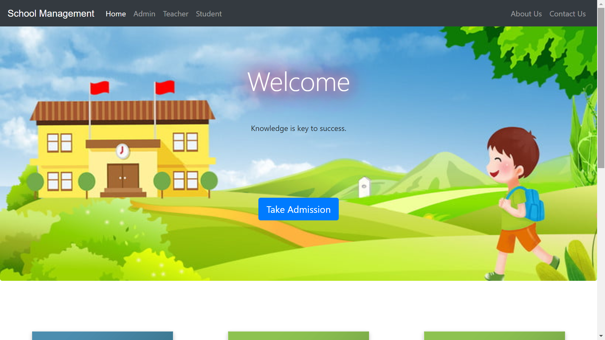
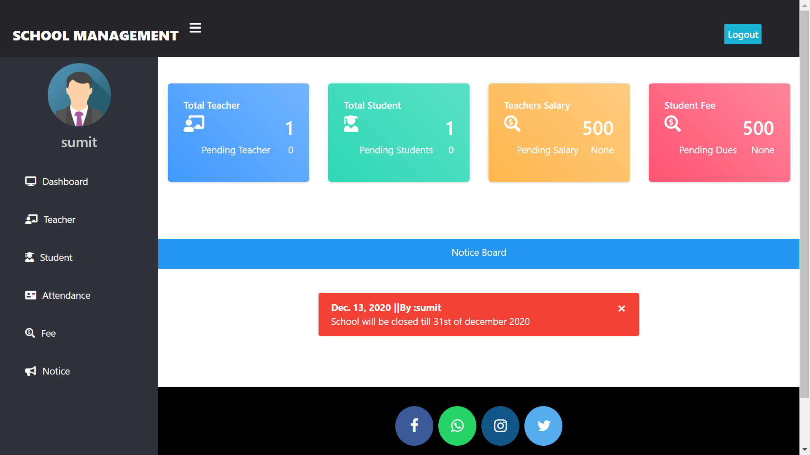
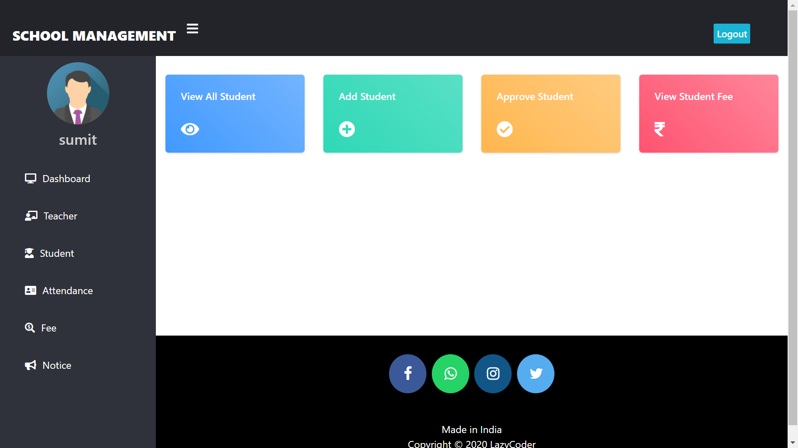
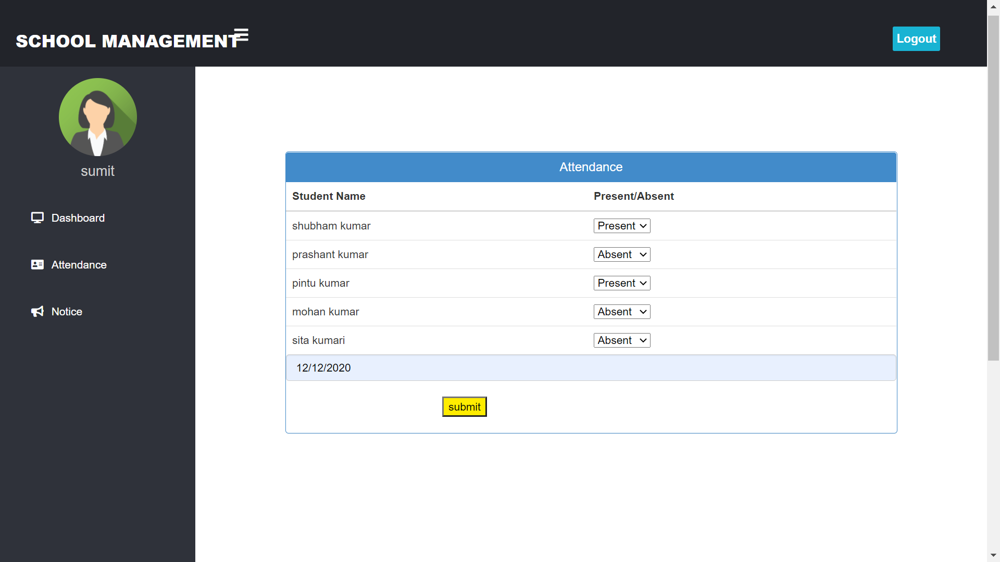
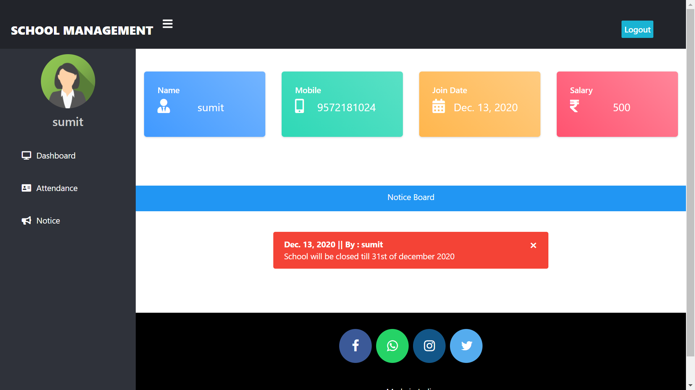

# School Management System
[](https://daggavoluganesh.github.io/school-management-system/)
[](https://github.com/daggavoluganesh)

> 🌐 **Live Interactive Website:** **[https://daggavoluganesh.github.io/school-management-system/](https://daggavoluganesh.github.io/school-management-system/)**

---
### Homepage

### Admin Dashboard

### Admin Manage Teacher

### Attendance

### Teacher Dashboard

---

## Functions
### Teacher
First the teacher will apply for job, if he/she gets selected their account will be made and approved by the admin, after approval only teacher can access their dashboard.
After account approval by admin, teacher can take attendance of any class and view their attendance later.
Teacher can also publish/announce notice to student like submission of assignments.

## Student
First student will take admission/signup.
When their account is approved by admin, only then the student can access their dashboard.
After account approval by admin the student can view their details like attendance.
Student can't view attendance of other student.
Student can't announce, they can only view.

### Admin
First admin will signup for an account.
After login they can see how many students/teachers want to get job/admission in their school.
They can approve or delete/cancel the request.
They can update any student/teacher details.
Admin can announce notice also.


## Features & Improvements Made
- Upgraded compatibility to support modern Python (3.10, 3.11, 3.12, 3.13+) and Django 5.x / 6.x.
- Fixed update page so password changes are optional (leaving password blank keeps existing login credentials intact).
- Fixed Django 5+ logout issue (GET requests now cleanly log out and redirect).
- Fixed form validation and error reporting across all signup/login/update pages.
- Fixed broken relative hyperlinks across student, teacher, and admin navigation.
- Fixed duplicate attendance creation using atomic `update_or_create`.
- Added automated unit and integration tests (`python manage.py test`).

## HOW TO RUN THIS PROJECT
1. Open Terminal in the project root folder.
2. Create and activate a virtual environment (optional but recommended):
```powershell
python -m venv venv
.\venv\Scripts\activate
```
3. Install required packages:
```powershell
pip install -r requirements.txt
```
4. Run migrations and start server:
```powershell
python manage.py migrate
python manage.py runserver
```
5. Open your browser and navigate to:
```
http://127.0.0.1:8000/
```

## CHANGES REQUIRED FOR CONTACT US PAGE
- In settings.py file, You can configure your email credentials:
```python
EMAIL_HOST_USER = 'youremail@gmail.com'
EMAIL_HOST_PASSWORD = 'your_app_password'
EMAIL_RECEIVING_USER = ['youremail@gmail.com']
```

## Disclaimer
This project is developed for educational and demo purposes.

## Author & Feedback
Developed by **Ganesh Daggavolu**. Any suggestions and feedback are welcome!
